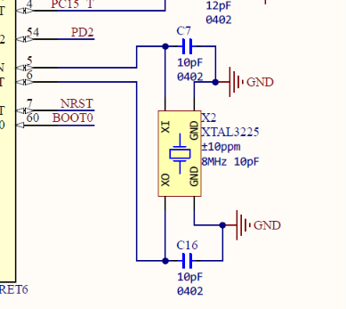
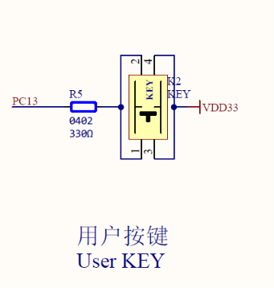
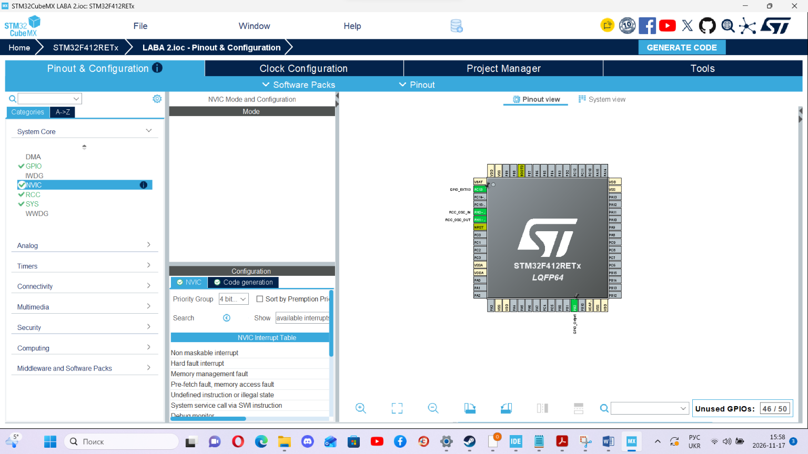
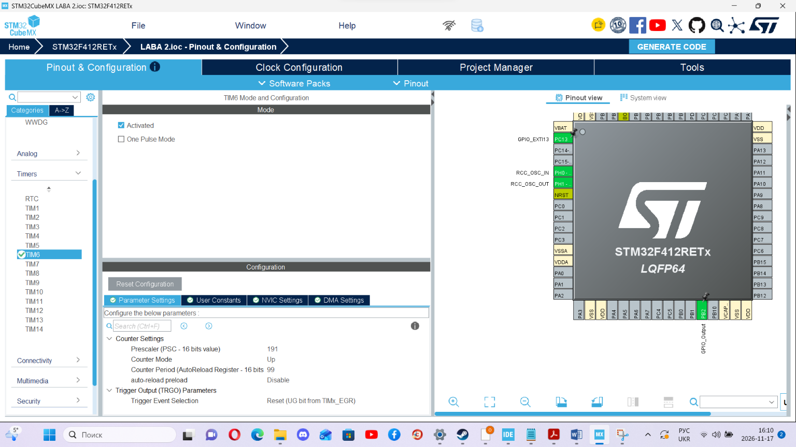
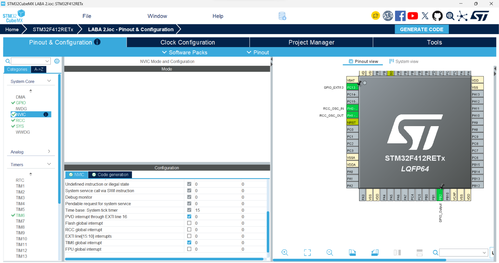

Завдання : фомувати сигнал для світлоліода на портуB апаратний вивід 2 з використанням таймера з використанням переривання щоб формувся ШіМ з частотою 50 гц зміна Ширини імпульса (інтенсивність світлодіода з використанням кнопки на порту С апаратний вивід 13)
На нашій платі є зовнішній кварцовий резонатор X2 на частоту 8 МГц (підключений до виводів OSC_IN та OSC_OUT мікроконтролера STM32 з навантажувальними конденсаторами C7 та C16 по 10 пФ).

Ми підключемо його як зовнішнє джерело тактування HSE (Crystal/Ceramic Resonator). 
1 Для початку зробимо попереднє налаштування проєкту в STM32CubeMX:

1)	Налаштування портів вводу/виводу (GPIO):

На інтерактивній схемі мікроконтролера (Pinout view) налаштовано два виводи:
1 PB2 (Світлодіод): переведено в режим GPIO_Output. 
2 PC13 (Кнопка): переведено в режим GPIO_EXTI13 (зовнішнє переривання). У параметрах GPIO обрано спрацювання по наростаючому фронту сигналу (External Interrupt Mode with Rising edge trigger detection) та увімкнено внутрішню підтяжку до землі (Pull-down).
Схема підключення кнопки : 

2)	Налаштування тактування (RCC та Clock Configuration)

У вкладці Pinout & Configuration -> System Core -> RCC для параметра High Speed Clock (HSE) обрано режим Crystal/Ceramic Resonator (оскільки на платі є зовнішній кварц на 8 МГц).
У вкладці Clock Configuration налаштовано схему множення частоти PLL:
Input frequency (HSE): вказано 8 МГц.
PLLM: встановлено дільник /8 (опорна частота 1 МГц).
PLLN: встановлено множник x192 (частота VCO = 192 МГц).
PLLP: встановлено дільник /2, після чого в мультиплексорі System Clock Mux обрано PLLCLK (системна частота SYSCLK = 96 МГц).
APB1 Prescaler: встановлено /2 (шина периферії PCLK1 працює на частоті 48 МГц, але таймери на цій шині використовують автоматичний множник x2, тому їхня частота APB1 Timer clocks становить 96 МГц).
3)	Розрахунок та налаштування базового таймера TIM6(вибрано через те що він простий)

Математичний розрахунок параметрів:
Частота тактування таймера становить F_TIM6 = 96 МГц.
Необхідна частота ШІМ за завданням становить 50 Гц  отже повний період одного циклу дорівнює:

T=1/50=0.02c
Для регулювання яскравості від 0% до 100% період вирішино розбити  на 100 кроків. Таким чином, переривання таймера має виникати кожні:
Ttim6=20000/100=200 мкс=2*〖10〗^(-4) с
	Параметри, введені у CubeMX для TIM6:
Prescaler (PSC):нам потрібно 200 мкс 
Для цього визначимо потрібну частоту : 
 
Ftime6=1/(2*〖10〗^(-4) )=5000 Гц
ділимо 96 МГц на 191 + 1 = 192, що дає частоту лічильника 500 кГц яка необхідна нам 
Counter Mode: Up (рахунок вгору).
Counter Period (ARR): 99 (таймер рахує від 0 до 99 — рівно 100 тіків, що дає рівно 100 × 2 мкс = 200 мкс до переповнення)
4) Налаштування контролера переривань (NVIC)

У налаштуваннях NVIC (System Core -> NVIC) поставлено галочки для активації двох векторів переривань:
1.	TIM6 global interrupt — для обробки переповнення таймера кожні 200 мкс.
2.	EXTI line[15:10] interrupts — для реакції на натискання кнопки на піні PC13
5)	Дописання коду :
Після генерації ми добавили ще такий код: 
Оголошення глобальних змінних (секція USER CODE BEGIN 0)
volatile uint8_t pwm_counter = 0;
volatile uint8_t duty = 5;
volatile — спеціальний модифікатор для компілятора. Він вказує, що значення цих змінних можуть змінюватися раптово (всередині обробників переривань), тому компілятор не повинен оптимізувати або кешувати їх у регістрах процесора.
uint8_t pwm_counter = 0; — змінна-лічильник поточного кроку ШІМ (від 0 до 99). Вона відраховує 100 частин одного повного періоду сигналу.
uint8_t duty = 5; — змінна, яка зберігає коефіцієнт заповнення (шпаруватість) у відсотках. Початкове значення 5 задає мінімальну яскравість світлодіода (5%) одразу після подачі живлення на плату.
Запуск базового таймера з перериваннями (секція USER CODE BEGIN 2)
HAL_TIM_Base_Start_IT(&htim6);
HAL_TIM_Base_Start_IT(&htim6); — функція бібліотеки HAL, яка запускає лічильник таймера TIM6 у базовому режимі та дозволяє генерацію переривань (IT — Interrupt) при кожному його переповненні (тобто кожні 200 мкс). Переданий параметр &htim6 — це вказівник на структуру налаштувань шостого таймера.

Функція обробки переривання таймера — генерація ШІМ (секція USER CODE BEGIN 4)
Функція HAL_TIM_PeriodElapsedCallback автоматично викликається мікроконтролером щоразу, коли таймер дораховує до кінця (кожні 200 мкс, або 5000 разів на секунду):
void HAL_TIM_PeriodElapsedCallback(TIM_HandleTypeDef *htim) {
    if (htim->Instance == TIM6) {
        if (pwm_counter < duty) {
            HAL_GPIO_WritePin(GPIOB, GPIO_PIN_2, GPIO_PIN_SET);
        } else {
            HAL_GPIO_WritePin(GPIOB, GPIO_PIN_2, GPIO_PIN_RESET);
        }
        pwm_counter++;
        if (pwm_counter >= 100) {
            pwm_counter = 0;
        }
    }
}
if (htim->Instance == TIM6) — перевірка джерела переривання. Оскільки ця функція є спільною для всіх таймерів мікроконтролера, ми переконуємося, що переривання викликав саме таймер TIM6.
if (pwm_counter < duty) — порівняння поточного кроку лічильника із заданою яскравістю. Наприклад, якщо duty = 25, то перші 25 кроків (від 0 до 24) ця умова буде істинною.
HAL_GPIO_WritePin(GPIOB, GPIO_PIN_2, GPIO_PIN_SET); — якщо умова виконується, на 2-й вивід порту B (PB2) подається високий логічний рівень (1 / 3.3 В), і світлодіод вмикається.
else { HAL_GPIO_WritePin(GPIOB, GPIO_PIN_2, GPIO_PIN_RESET); } — коли лічильник досягає значення duty і перевищує його (наприклад, кроки від 25 до 99), на вивід PB2 подається низький логічний рівень (0 / 0 В), і світлодіод вимикається до кінця періоду.
pwm_counter++; — збільшення лічильника кроків на одиницю при кожному вході в переривання.
if (pwm_counter >= 100) { pwm_counter = 0; } — коли лічильник досягає 100 (пройшло 100 × 200 мкс = 20 мс, що відповідає частоті 50 Гц), він обнуляється, і починається формування нового періоду ШІМ-сигналу.
 Функція обробки зовнішнього переривання від кнопки (секція USER CODE BEGIN 4)
Функція HAL_GPIO_EXTI_Callback спрацьовує автоматично при натисканні кнопки (поява наростаючого фронту сигналу):
void HAL_GPIO_EXTI_Callback(uint16_t GPIO_Pin) {
    if (GPIO_Pin == GPIO_PIN_13) {
        duty += 10;
        if (duty > 100) {
            duty = 10;
        }
    }
}
if (GPIO_Pin == GPIO_PIN_13) — перевірка, що зовнішнє переривання прийшло саме з 13-ї лінії (пін PC13, до якого підключена кнопка користувача).
duty += 10; — збільшення ширини імпульсу (коефіцієнта заповнення ШІМ) на 10% при кожному натисканні кнопки, що візуально збільшує яскравість світлодіода.
if (duty > 100) { duty = 10; } — захист від виходу за межі максимальної шпаруватості (100%). Як тільки яскравість перевищує 100%, вона скидається на початковий рівень 10%, і цикл регулювання починається заново.
РЕзультат : 
